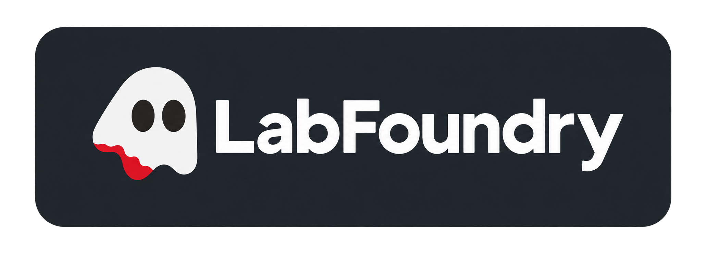

  

# LabFoundry

LabFoundry compiles YAML scenarios into GNS3 topologies, schedules activity in the guests,
and exports PCAP or PCAPNG captures with separate execution records. Applications run inside
the guests and generate the traffic. The scenario seed controls planning and scheduling.

LabFoundry requires Python 3.12 or newer. Deployment requires GNS3 Server `>=2.2.61,<2.3.0`.
Validation, compilation, and diagram generation run offline.

LabFoundry currently supports these managed guest setups:

| Setup | When to use it |
| --- | --- |
| [VirtualBox](docs/getting-started/quickstart.md#virtualbox) | Use individual VMs for Windows guests, separate kernels, or workloads that need a full VM. |
| [Incus on VirtualBox](docs/guide/incus.md) | Start here for Linux workloads that can share a kernel and a scenario clock. Each node runs in a system container inside one dedicated VM per scenario. |

SSH is also available as a guest transport for command and file operations.

## Getting started

Install a published release with `python -m pip install labfoundry` or install a source
checkout with `python -m pip install -e .`.

1. Follow the [installation guide](docs/getting-started/installation.md) for LabFoundry and
   your guest transport.
2. Define the scenario using the [scenario DSL](docs/reference/scenario-dsl.md) and configure
   the [guest inventory](docs/guide/guest-execution.md).
3. Follow the [quickstart](docs/getting-started/quickstart.md) to validate, compile, and run
   the scenario. Supply the templates and application assets it uses.

Runs store published captures under `evidence/` and raw captures and execution records under
`internal/`. The [capture guide](docs/guide/captures.md) covers timestamp mapping and the
audit that controls publication.

## Resource measurements

The original layout allocated one VirtualBox VM with 3 GiB of RAM and 1 vCPU per node.
The same workloads were run with Incus system containers sharing one VirtualBox VM.

| Nodes | Individual VMs, total allocated | Shared VM, allocated | Peak memory inside shared VM | Peak CPU inside shared VM |
| ---: | --- | --- | ---: | ---: |
| 10 | 30 GiB / 10 vCPU | 12 GiB / 8 vCPU | 2,733.02 MiB | 6.44 vCPU |
| 11 | 33 GiB / 11 vCPU | 8 GiB / 8 vCPU | 2,740.03 MiB | 6.54 vCPU |
| 10 | 30 GiB / 10 vCPU | 12 GiB / 8 vCPU | 3,038.10 MiB | 7.53 vCPU |

Guest memory is allocated RAM minus Linux `MemAvailable`. CPU is peak utilization over an
approximately one-second sample. On Windows, the 11-node shared VM peaked at 8,438.49 MiB
of host working set. The smallest shared VM that completed these runs had 8 GiB allocated.

## Development

See [Contributing](CONTRIBUTING.md) for setup and test commands, the
[architecture notes](docs/advanced/architecture.md) for the code layout, and the
[API reference](docs/reference/api/index.md) for Python interfaces.

Released under the [MIT License](LICENSE).

## Project origins

As a member of the teaching team for Cibersegurança Forense at Instituto Superior Técnico
in 2026/27, I developed LabFoundry to prepare the course's third lab. It was used to build and
simulate complete enterprise networks, from segmented and routed topologies to workstations and
web, mail and database services. Each scenario used its own IP addressing and DNS domains, with
TLS certificates issued by private certificate authorities created for the lab.

The lab traffic came from real applications running on that infrastructure. Browsers resolved
the lab's DNS names, connected over TLS using the lab's trust chains, and loaded pages and
transferred files with time allowed for reading and for server responses. The scenarios assigned
addresses and service identities independently, so the traffic reflected each network's own
topology and configuration.

Guest clocks followed the simulated timeline. LabFoundry skipped long idle periods during
execution, then mapped packet timestamps back to scenario time so the exported captures retained
the intended gaps and the timing of active exchanges. The PCAPNG captures and TLS session key
logs let students correlate activity across hosts and decrypt the corresponding sessions during
forensic analysis.
